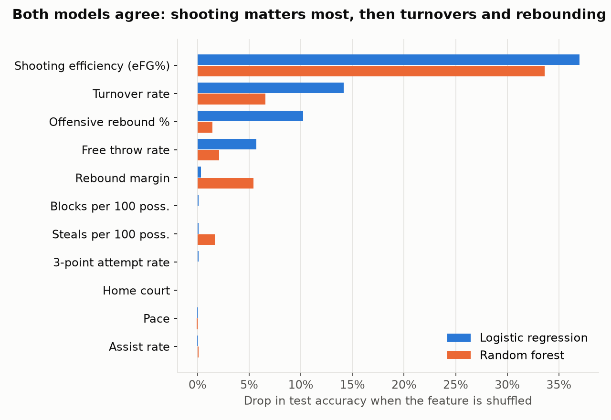
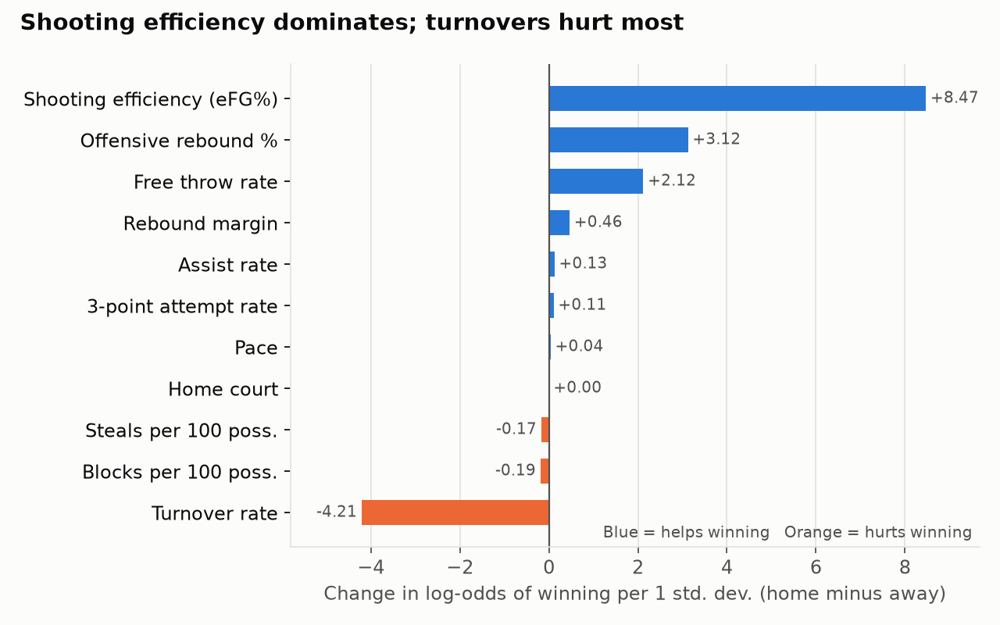
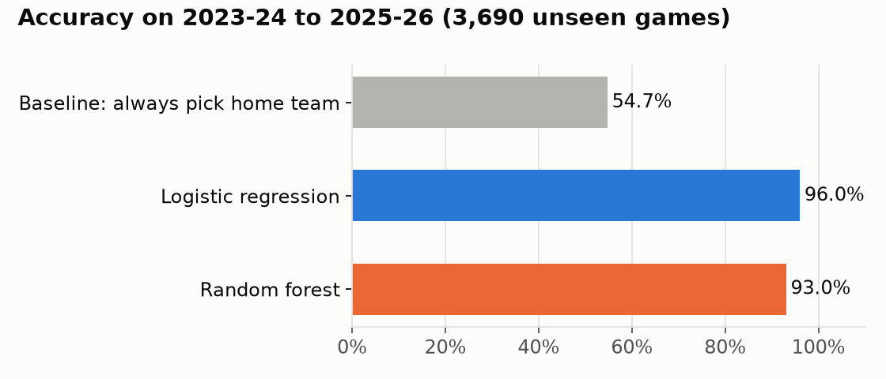

# Which team stats best predict NBA wins?

I analyzed **11,979 NBA regular-season games (2016-17 to 2025-26)** to find which box-score stats separate winners from losers. I trained two models on the first seven seasons and tested them on the three most recent ones.

## Key findings

1. **Shooting efficiency decides games.** The team with the better effective field goal % (a shooting percentage that counts a three as 1.5 makes) wins most of the time. Remove it from the model and accuracy drops by about 35 percentage points, more than every other stat combined.
2. **After shooting: turnovers, offensive rebounds, free throws, in that order.** This matches basketball analyst Dean Oliver's "Four Factors" theory, now confirmed on ten years of recent data.
3. **Pace, 3-point volume and assists barely matter on their own.** Taking *more* threes doesn't win games; *making* shots does. Playing fast or slow has no effect on who wins.
4. **Home court works mostly through the stats.** Home teams win 56% of games. Give both teams identical stats and the home team still wins about 52%, so most of the edge shows up *as* better shooting, with only a small extra bump on top.
5. **A simple model is enough.** Logistic regression (96% accuracy) beat a random forest (93%). The relationships are mostly straight lines, so the more complex model had nothing extra to find.







## How it works

| Step | What happens | Where |
|---|---|---|
| 1. Data | Download every team box score for 10 seasons from stats.nba.com with `nba_api` | [`src/fetch_data.py`](src/fetch_data.py) |
| 2. Features | Turn raw counts into rates (per possession or per shot), then take **home minus away** for each game | [`src/build_features.py`](src/build_features.py) |
| 3. Models | Logistic regression and random forest. **Train on 2016-17 to 2022-23, test on 2023-24 to 2025-26**, with no random shuffling | [`notebooks/analysis.ipynb`](notebooks/analysis.ipynb) |
| 4. Importance | Standardized coefficients plus permutation importance on the test set | same notebook |

### Design choices worth noting
- **No leakage from the final score.** Points and plus-minus were left out because they *are* the result. Including them would make the model look perfect and teach nothing.
- **Rates, not totals.** Fast teams take more shots *and* commit more turnovers just because they have more possessions. Dividing by possessions makes teams comparable.
- **One row per game.** The raw data lists each game twice (once per team). Keeping both copies would double-count every game.
- **Time-based split.** Testing on later seasons copies real use and checks that the findings still hold as the league changes (for example, more threes every year).

## Limitations
- **This explains wins; it doesn't forecast them.** The features come from the game itself, which is why accuracy is so high. The project answers *what matters*, not *who wins tomorrow*.
- **Team level only.** It doesn't say which *players* drive these stats.
- **Regular season only.** Playoff basketball (repeated opponents, tighter rotations) may behave differently.

## Next step: a preseason "Moneyball" projection
The planned extension uses these findings to value **players**: rate each one on the stats that matter most (shooting efficiency, turnovers, rebounding), add a roster together weighted by expected minutes, and predict a team's wins *before* the season. Then test how much a new signing changes the projection.

## Run it yourself
```bash
python3 -m venv .venv && source .venv/bin/activate
pip install -r requirements.txt
python src/fetch_data.py        # optional: data/raw is already included
python src/build_features.py
jupyter notebook notebooks/analysis.ipynb
```

**Tools:** Python, pandas, scikit-learn, matplotlib, Jupyter, nba_api
