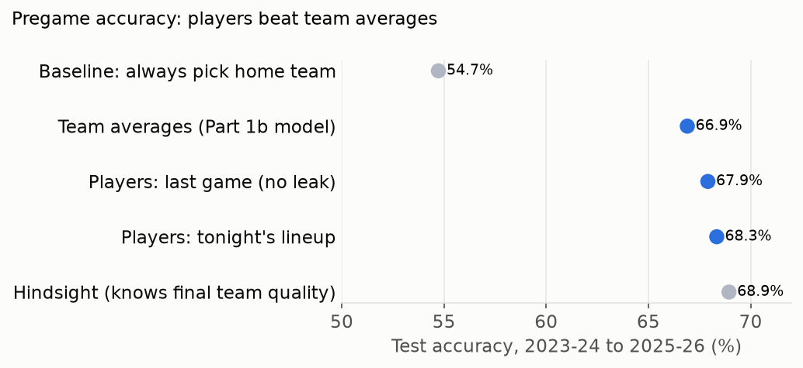
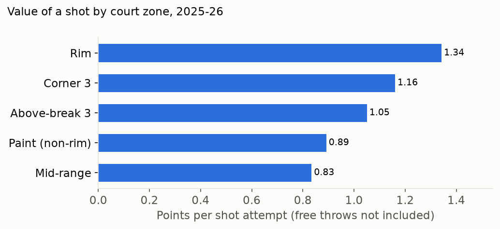
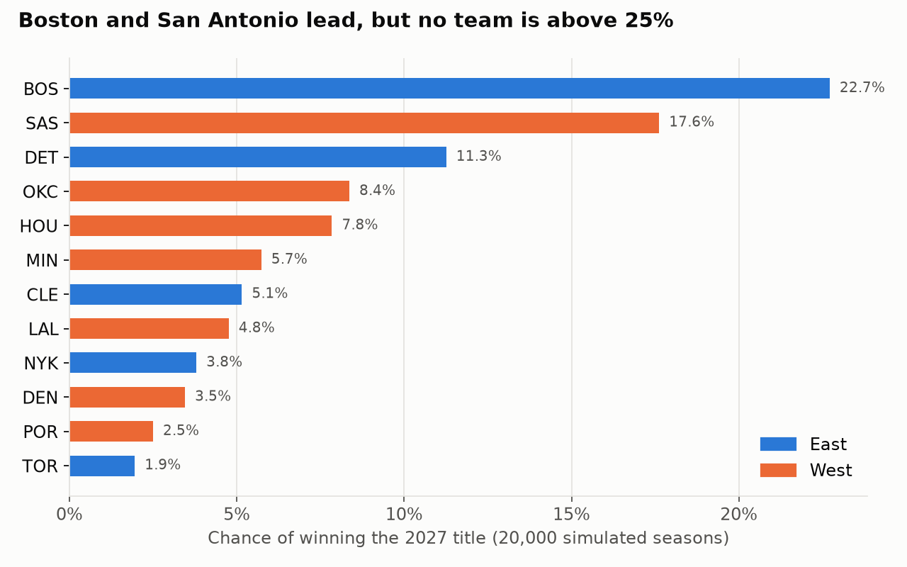
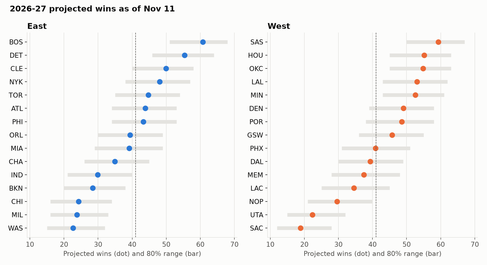

# NBA Win Predictors: what wins games, and who will win this season

I analyzed **11,979 NBA regular-season games across 10 seasons (2016-17 to 2025-26)**. Every model trains on the first seven seasons (8,289 games) and is tested on the three most recent (**2023-24, 2024-25, 2025-26**: 3,690 games). The split is by season, never random.

## Results at a glance

| Question | Model | Train accuracy | Test accuracy |
|---|---|---|---|
| — | Baseline: always pick the home team | 56.9% | **54.7%** |
| **Who will win?** (pregame info only) | Logistic regression (team averages) | 64.4% | **66.9%** |
| | Random forest (team averages) | 66.6% | **66.3%** |
| | **Player-based strength** (tonight's lineup) | 65.7% | **68.3%** |
| | Player-based strength (last game's players, zero leakage) | 65.1% | 67.9% |
| **What explains a win?** (stats from the game itself) | Logistic regression | 95.7% | 96.0% |
| | Random forest | 94.6% | 93.0% |

**Why two questions?** An audit found that same-game shooting, free throw, turnover and rebounding rates rebuild a team's points per possession with 98% accuracy, so they come close to revealing the final score. The 96% models are useful for *explaining* what wins, but they aren't forecasts. The pregame models are the honest forecast. The best one builds each team from **its players** (ratings × expected minutes) and reaches **68.3%, about 14 points above the baseline**.

## Key findings: what explains a win

1. **Shooting efficiency decides games.** The team with the better effective field goal % (a shooting percentage that counts a three as 1.5 makes) wins most of the time. Remove it from the model and accuracy drops by about 35 percentage points, more than every other stat combined.
2. **After shooting: turnovers, offensive rebounds, free throws, in that order.** This matches basketball analyst Dean Oliver's "Four Factors" theory, now confirmed on ten years of recent data.
3. **Pace, 3-point volume and assists barely matter on their own.** Taking *more* threes doesn't win games; *making* shots does. Playing fast or slow has no effect on who wins.
4. **Home court works mostly through the stats.** Home teams win 56% of games. Give both teams identical stats and the home team still wins about 52%, so most of the edge shows up *as* better shooting, with only a small extra bump on top.
5. **A simple model is enough.** Logistic regression (96% accuracy) beat a random forest (93%). The relationships are mostly straight lines, so the more complex model had nothing extra to find.


## Key findings: forecasting before tip-off
- **Net rating so far is the best single predictor** (points scored minus allowed per 100 possessions). It already combines all Four Factors.
- **Top 5 pregame features** (logistic regression, standardized coefficients): net rating +0.23, win % +0.23, shooting (eFG%) +0.19, rest days +0.11, defensive rebound % +0.10.
- **Surprise 1: the test seasons were *easier* to predict than the training seasons** (66.9% vs 64.4%). Recent seasons had bigger gaps between the best and worst teams (the spread of team win % rose from 0.14 to 0.165), so favorites won more often.
- **Surprise 2: rest days have a clear coefficient but add almost no accuracy.** A rested team wins slightly more often, but rest rarely changes *who is favored*, so it seldom flips a prediction.
- **Overfitting caught and fixed:** the first random forest scored 74.5% on training games but 66.1% on test games. Requiring each leaf to cover 100+ games closed the gap (66.6% vs 66.3%) with no loss on test.

## Predicting games from players, not team averages
Team averages can't tell when a star sits out. So each team's pregame strength is built from its players: each player's rating (Part 2) × expected minutes, using only information from before the game. Ratings are refit every 14 days from earlier games only.



- **Players beat team averages:** 68.3% vs 66.9%, and log loss (a check that the predicted *probabilities* are right) improves from 0.607 to 0.588.
- **Honest about leakage:** "tonight's lineup" uses who actually played, which in real use comes from the injury report and starting lineups shortly before tip-off. Coach's-decision benchings aren't known in advance, so I also built a zero-leakage version from the previous game's players. It still reaches 67.9%.
- **Near the ceiling:** with hindsight, knowing every team's full-season quality only reaches 68.9%. The rest is game-to-game luck no pregame model can see.

## Live test: 1,000 games predicted before tip-off
Backtests can hide mistakes, so the models are now **frozen** (trained on 2016-17 to 2025-26) and predicting 2026-27 games live, starting November 12, 2026. A few hours before each game, the system reads the official injury report, logs a win probability for the game and a points prediction for every player expected to play 20+ minutes, then commits the log to GitHub. The commit timestamps prove each prediction was made before tip-off.

- **Scorecard:** [`predictions/SCORECARD.md`](predictions/SCORECARD.md) (accuracy, calibration, points error), updated automatically
- **Raw logs:** [`predictions/games.csv`](predictions/games.csv) and [`predictions/props.csv`](predictions/props.csv)
- **Rules:** the models don't change during the test. Any idea for improving them gets written down first and tested at the end.
- **Code:** [`src/predict_today.py`](src/predict_today.py), [`src/grade_predictions.py`](src/grade_predictions.py), [`scripts/run_daily.sh`](scripts/run_daily.sh)

## Can it beat the betting market? No, and here's the proof
Picking winners isn't how betting pays: favorites pay little, and point-spread bets need 52.4% wins to break even at standard -110 odds. So I tested the model against **real BetMGM closing odds** on 3,257 test games (2023-24 through Feb 2026):

| Who | Picked the winner | Log loss (lower = better) |
|---|---|---|
| **Betting market** | **68.4%** | **0.590** |
| Our model (tonight's lineup) | 67.2% | 0.601 |
| Our model (zero leakage) | 67.0% | 0.608 |

- **The market wins.** Closing odds already include everything the model knows, plus late injury news and money from professional bettors.
- **The model adds almost nothing on top.** Combining the two puts 0.95 of the weight on the market and 0.09 on the model.
- **Betting on it loses money.** Betting only when the model disagrees with the odds lost 0.6% to 10.5% in 15 of 16 settings. The one profitable setting (+0.6% on 281 bets) is the best of 16 tries and well within luck.
- **Why it matters:** 68% accuracy sounds impressive, but the market is the real bar. Testing against it separates a real edge from a good-looking number.

## Testing a fan's hypothesis: is the modern NBA all about the 3?
From watching games, my theory was: score in fewer seconds than the opponent, and favor 3s over 2s over mid-range shots. The data says I was **mostly right**, with one surprise:

| The team that… | Won this often |
|---|---|
| Played faster (more possessions) | ~42% |
| Took more 3s | ~50% (coin flip) |
| Made more 3s | ~66% |
| Had the higher 3P% | ~71% |
| Scored more points per possession | **~96%** |

- **Efficiency, not speed.** Playing fast doesn't win. Scoring more *per trip* does.
- **Making 3s matters; taking them doesn't.**
- **Shot value: rim > corner 3 > above-break 3 > paint > mid-range.** Mid-range really is the worst shot, and teams have cut it in half since 2016-17. The surprise: shots at the rim are worth even more than 3s.
- **Corner 3s are the shot mix most linked to winning** (correlation 0.25 with win %, within each season).
- **No forecasting gain.** Adding 3-point stats to the pregame model moved accuracy from 66.9% to 67.0%, because net rating already captures shooting.



## How it works

| Step | What happens | Where |
|---|---|---|
| 1. Data | Download every team box score for 10 seasons from stats.nba.com with `nba_api` | [`src/fetch_data.py`](src/fetch_data.py) |
| 2. Features | Turn raw counts into rates (per possession or per shot), then take **home minus away** for each game | [`src/build_features.py`](src/build_features.py) |
| 3. Models | Logistic regression and random forest. **Train on 2016-17 to 2022-23, test on 2023-24 to 2025-26**, with no random shuffling | [`notebooks/analysis.ipynb`](notebooks/analysis.ipynb) |
| 4. Importance | Standardized coefficients plus permutation importance on the test set | same notebook |
| 5. Pregame model | Each team's season-to-date averages *before* each game, blended with last season early on | [`src/build_pregame_features.py`](src/build_pregame_features.py) |
| 6. Player-based model | Team strength from player ratings × expected minutes, before each game | [`src/build_player_strength.py`](src/build_player_strength.py), notebook Part 1d |
| 7. Market test | Compare win probabilities with BetMGM closing odds and simulate bets | notebook Part 1e |
| 8. Shot value | Points per shot by court zone and how shot mix relates to winning | [`src/fetch_shot_zones.py`](src/fetch_shot_zones.py), notebook Part 1c |

### Design choices worth noting
- **No direct score leakage.** Points, points allowed, point differential and plus-minus are never used as same-game features. The indirect leak (shooting + free throws + turnovers + rebounds ≈ points) is why the forecasting question uses pregame data only.
- **Rates, not totals.** Fast teams take more shots *and* commit more turnovers just because they have more possessions. Dividing by possessions makes teams comparable.
- **One row per game.** The raw data lists each game twice (once per team). Keeping both copies would double-count every game.
- **Time-based split.** Testing on later seasons copies real use and checks that the findings still hold as the league changes (for example, more threes every year).

## Limitations
- **The 96% models explain; only the pregame model forecasts.** Don't quote 96% as prediction accuracy.
- **Team level only.** It doesn't say which *players* drive these stats.
- **Regular season only.** Playoff basketball (repeated opponents, tighter rotations) may behave differently.

---

# Part 2: Moneyball. Rating players, projecting 2026-27, finding trades

Part 1 asked *which stats win games*. Part 2 turns that into decisions: **how good is each player, how many games will each team win this season, who should they trade for, and who will win the title?** Data runs through **November 11, 2026**, about 12 games into the season.





## Key findings
1. **Boston (22.7%) and San Antonio (17.6%) are the title favorites**, followed by Detroit (11.3%). No team is above 25%, so the playoffs are wide open.
2. **Hot starts can mislead.** Philadelphia is 9-3 but projects for only 43 wins. The Lakers are 11-2 but project below Houston and OKC. The rosters don't support the early records.
3. **The best players by our rating:** Shai Gilgeous-Alexander, Victor Wembanyama and Nikola Jokić. These ratings come from a method we built, not one we borrowed.
4. **Top trade targets for contenders:** Devin Booker, Michael Porter Jr., Giannis Antetokounmpo and Brook Lopez. For example, OKC adding Booker projects as about **+4.5 wins**.

## How it works

| Step | What happens | File |
|---|---|---|
| Player data | Every player's box score for every game, 2015-16 to today, plus current rosters and the remaining schedule | [`src/fetch_players.py`](src/fetch_players.py) |
| Player rating | **RAPM with a box-score prior.** Box stats give a first guess (learned from history), and the team's actual margin with the player on the floor adjusts it. Uses this season + last season (+ the season before at half weight) and a learned **age curve** | [`src/ratings.py`](src/ratings.py) |
| Injuries | Reads the NBA's **official injury report PDFs** and sorts each injury into an expected absence (e.g. fresh ACL tear = out for the season) | [`src/injuries.py`](src/injuries.py) |
| Team strength | Each player's rating × expected minutes (blending this season and last, adjusted for availability and injuries) | [`src/project.py`](src/project.py) |
| Win projection | Every remaining game becomes a win probability from the strength gap + home court | [`src/project_current.py`](src/project_current.py) |
| Trades | For each contender, try every healthy veteran on a losing team and measure the extra wins | [`src/trades.py`](src/trades.py) |
| Title odds | Simulate the rest of the season, play-in and playoffs **20,000 times** | [`src/simulate.py`](src/simulate.py) |

## Does it work? A backtest on 9 past seasons
I replayed 2017-18 to 2025-26, stopping each one at the same point in the season as today and using **only data available at that moment**:

| Method | Average miss (wins) |
|---|---|
| **This model** | **6.0** (6.1 before tuning) |
| Average of last season and record so far | 6.7 |
| Record so far | 8.7 |
| Last season's record | 8.7 |

**Caveat:** the final settings (a 3-season window, the age curve and the regularization strength) were chosen by looking at this same backtest, so 6.0 is slightly optimistic. The untuned version scored 6.1, so the honest range is 6.0–6.1. An audit also fixed a small leak (league averages briefly used the full season), which changed the result by only 0.01.

Even with perfect knowledge of every team's true strength, luck alone would cause about 2.4 wins of error. Most of the remaining gap comes from things no model can see in advance: future injuries, trades and breakout seasons. The backtest also measured how far a team's true strength can be from our estimate (±3.3 points), and the simulation includes that uncertainty so the odds aren't overconfident.

## Limitations
- **Trades ignore salary and team fit.** The model knows how many wins a player is worth, not whether he fits a roster's needs or whether the contracts can be matched. That's why most contenders name the same few targets. **Team fit is the next planned upgrade.**
- **Game-level, not possession-level, plus-minus.** Bench players on dominant teams can come out a little high.
- **Injury return dates are estimated** from the injury description, since the official report lists status, not timelines.

## Run it yourself
```bash
python3 -m venv .venv && source .venv/bin/activate
pip install -r requirements.txt
python src/fetch_data.py        # optional: data/raw is already included
python src/fetch_shot_zones.py  # optional: shot locations for Part 1c
python src/build_features.py
python src/build_pregame_features.py
python src/build_player_strength.py
jupyter notebook notebooks/analysis.ipynb   # Part 1, 1b-1e: models, feature importance, shot value, player model, market test

# Part 2 (data/raw is included; re-fetch to update to today)
python src/fetch_players.py && python src/fetch_ages.py && python src/fetch_injuries.py
cd src
python backtest.py          # check the method on past seasons
python project_current.py   # 2026-27 projected wins
python trades.py            # trade targets
python simulate.py          # championship odds
python plot_moneyball.py    # charts
```

**Data credit:** betting odds from [MGM Grand NBA betting data](https://www.kaggle.com/datasets/caseydurfee/mgm-grand-nba-betting-data) by Casey Durfee (CC BY-SA 4.0), saved as `data/raw/betting_odds_mgm.csv`. Game and player stats from stats.nba.com via `nba_api`.

**Tools:** Python, pandas, NumPy, SciPy, scikit-learn, matplotlib, Jupyter, nba_api, pdfplumber
