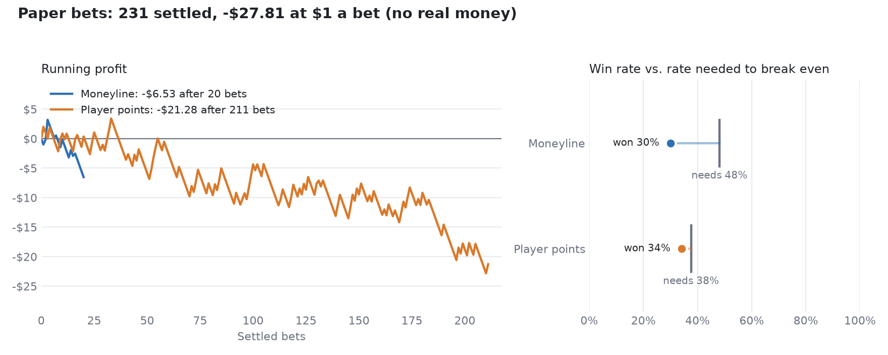

# Live prediction scorecard

Updated 2026-11-20. Model frozen on 2026-11-12. Game grading checks recorded prediction times precede tip-off; timestamps alone do not independently prove publication or input availability.

## Bets so far (pretend $1 bets, no real money)

| | Bets placed | Finished | Won | Lost | Win rate | Profit or loss |
|---|---|---|---|---|---|---|
| Game winner | 27 | 20 | 6 | 14 | 30.0% | -$6.53 |
| Player points, before the lineup fix | 225 | 211 | 72 | 139 | 34.1% | -$21.28 |
| Player points, after the lineup fix | 93 | 0 | 0 | 0 | – | – |
| **Total** | **345** | **231** | **78** | **153** | **33.8%** | **-$27.81** |

Bets that are not finished are waiting for the game to end. Details are under [Paper bets](#paper-bets-no-real-money) below.

## Games: 47 graded of 1000 goal (9 pending)

Invalid game predictions excluded: 0.

- **Accuracy: 66.0%** (95% Wilson interval 51.7%–77.8%; assumes independent trials)
- Always picking the home team: 44.7%
- Log loss: 0.661 (lower is better; a coin flip is 0.693)

| Model's confidence | Games | Picks won |
|---|---|---|
| 50%–60% | 14 | 71.4% |
| 60%–70% | 8 | 62.5% |
| 70%–80% | 18 | 61.1% |
| 80%–100% | 7 | 71.4% |

## Player points: 599 graded

- **Average miss: model 5.27 pts vs season average 5.32 pts** (same 599 player-games)
- Scored over the prediction: 57.9% (about 50% means the median is right)
- Players who didn't play (void): 31

Until November 19, 2026 the live run fed the points model too many players per team, which made its predictions about 1 point too low. Predictions labelled v1.1 use the same frozen model with that fixed.

The scores above measure accuracy, not profit. Profit is tracked under paper bets.

## Paper bets (no real money)

A pretend $1 bet is logged before tip-off whenever the frozen model's chance times the best recorded price shows positive value. The main rule, fixed in advance, is value above 5%.

### Summary

| | All paper bets | Main rule (value above 5%) |
|---|---|---|
| Bets logged | 345 | 287 |
| Settled | 231 | 197 |
| Waiting for results | 100 | 79 |
| Void (player didn't play) | 14 | 11 |
| Won | 78 | 68 |
| Lost | 153 | 129 |
| Win rate | 33.8% | 34.5% |
| Win rate needed to break even | 38.5% | 37.1% |
| Average odds (payout per $1) | 2.73 | 2.80 |
| Money staked | $231 | $197 |
| Profit or loss | -$27.81 | -$14.41 |
| Return per $1 | -12.0% | -7.3% |

Could the main rule's result be luck? yes (±19%).

### By market and rule

| Market | Rule | Settled | Won | Win rate | Break-even | Profit or loss | Return per $1 | Could be luck? |
|---|---|---|---|---|---|---|---|---|
| moneyline | any positive value | 20 | 6 | 30.0% | 48.1% | -$6.53 | -32.6% | too few bets to say |
| moneyline | **value above 5% (main rule)** | 14 | 4 | 28.6% | 41.6% | -$3.27 | -23.4% | too few bets to say |
| moneyline | value above 10% | 11 | 2 | 18.2% | 42.8% | -$6.46 | -58.7% | too few bets to say |
| points | any positive value | 211 | 72 | 34.1% | 37.6% | -$21.28 | -10.1% | yes (±18%) |
| points | **value above 5% (main rule)** | 183 | 64 | 35.0% | 36.8% | -$11.14 | -6.1% | yes (±19%) |
| points | value above 10% | 156 | 51 | 32.7% | 36.1% | -$15.93 | -10.2% | yes (±21%) |

### Day by day (all paper bets, last 14 days)

| Date | Settled | Won | Win rate | Profit or loss | Running total |
|---|---|---|---|---|---|
| 2026-11-19 | 39 | 9 | 23.1% | -$15.00 | -$27.81 |
| 2026-11-18 | 129 | 45 | 34.9% | -$13.47 | -$12.81 |
| 2026-11-17 | 63 | 24 | 38.1% | +$0.66 | +$0.66 |

### Latest settled bets

| Date | Bet | Book | Odds | Model's chance | Result | Profit or loss |
|---|---|---|---|---|---|---|
| 2026-11-19 | Keaton Wagler under 8.5 points | bovada | 2.55 | 42% | won | +$1.55 |
| 2026-11-19 | Stephon Castle under 14.5 points | bovada | 2.90 | 35% | lost | -$1.00 |
| 2026-11-19 | Julian Champagnie under 10.5 points | betrivers | 1.96 | 54% | lost | -$1.00 |
| 2026-11-19 | Keldon Johnson under 9.5 points | bovada | 2.65 | 46% | lost | -$1.00 |
| 2026-11-19 | Darius Garland under 19.5 points | betmgm | 1.95 | 53% | lost | -$1.00 |
| 2026-11-19 | Rui Hachimura under 9.5 points | bovada | 2.90 | 37% | lost | -$1.00 |
| 2026-11-19 | De'Aaron Fox under 12.5 points | bovada | 2.85 | 38% | won | +$1.85 |
| 2026-11-19 | Kris Dunn over 7.5 points | bovada | 2.80 | 37% | lost | -$1.00 |
| 2026-11-19 | Terrence Shannon Jr under 9.5 points | bovada | 2.85 | 44% | lost | -$1.00 |
| 2026-11-19 | Ayo Dosunmu under 14.5 points | bovada | 3.10 | 41% | won | +$2.10 |

Break-even is the win rate needed to make exactly $0 at the odds taken. Points lines can be recorded a few hours after the prediction, so some bets use an older prediction against a newer line. The full list is in [paper_bets.csv](paper_bets.csv).
